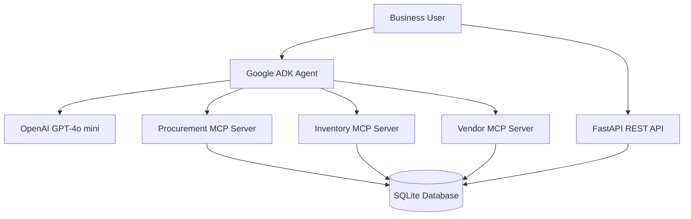

# 🚀 Retail Supply Chain – MCP Connected ADK Agentic AI

An AI-powered Retail Supply Chain Operations platform built using **Google Agent Development Kit (ADK), Model Context Protocol (MCP), OpenAI GPT-4o mini, Python, FastAPI and SQL**.

The platform uses specialized MCP servers to connect an AI agent with retail business data and perform intelligent procurement analysis, inventory monitoring and vendor performance management.

---

## 🎯 Project Overview

Retail supply chain operations involve multiple business processes, including:

- Purchase Order (PO) management
- Advance Shipping Notification (ASN) tracking
- Goods Receipt Note (GRN) monitoring
- Inventory management
- Vendor performance analysis
- Procurement exception identification

Traditionally, these activities require users to access multiple reports, databases and applications.

This project introduces an **Agentic AI approach** that allows users to ask questions in natural language and retrieve business insights through connected MCP tools.

### Example

**User:** List all problematic vendors.

**AI Agent:** Retrieves vendor performance data through the Vendor MCP Server, calculates ASN fill rates and GRN completion rates, and identifies vendors below the defined 90% performance threshold.

---

## 🏗️ System Architecture

### Architecture Components

| Component | Technology | Responsibility |
|---|---|---|
| AI Agent | Google ADK | Agent orchestration |
| LLM | OpenAI GPT-4o mini | Natural-language understanding and reasoning |
| Tool Integration | MCP | Connects the agent to business capabilities |
| Backend | Python | Business logic |
| API | FastAPI | REST API endpoints |
| Database | SQLite / SQL | Retail operations data |
| API Server | Uvicorn | Runs the FastAPI application |
| Containerization | Docker | Application container setup |

---

## 🧠 MCP Server Capabilities

The project currently contains three specialized MCP servers.

### 1. Procurement MCP Server

Responsible for purchase order analysis.

| Tool | Functionality |
|---|---|
| `search_purchase_orders` | Search purchase orders |
| `get_purchase_order` | Retrieve individual PO details |
| `calculate_po_quantities` | Calculate pending ASN and GRN quantities |

**MCP Resource:** Procurement PO policy.

**MCP Prompt:** PO exception review.

### 2. Inventory MCP Server

Responsible for inventory monitoring and GRN analysis.

| Tool | Functionality |
|---|---|
| `get_inventory` | Retrieve inventory by site |
| `find_low_stock` | Identify items below minimum stock |
| `get_grn_pending_summary` | Identify quantities pending GRN |

**MCP Resource:** Inventory stock policy.

### 3. Vendor MCP Server

Responsible for vendor information and performance analysis.

| Tool | Functionality |
|---|---|
| `get_vendor` | Retrieve vendor master details |
| `get_vendor_po_performance` | Analyze individual vendor performance |
| `get_all_vendor_performance` | Analyze performance across all vendors |

**MCP Prompt:** Vendor review.

---

## 📊 Business Intelligence Capabilities

### Procurement Management
- Purchase order search and retrieval.
- PO quantity analysis.
- Pending ASN calculation.
- Pending GRN calculation.

### Inventory Management
- Site-wise inventory visibility.
- Low-stock identification.
- Stock shortage calculation.
- Pending GRN summary.

### Vendor Performance Management
